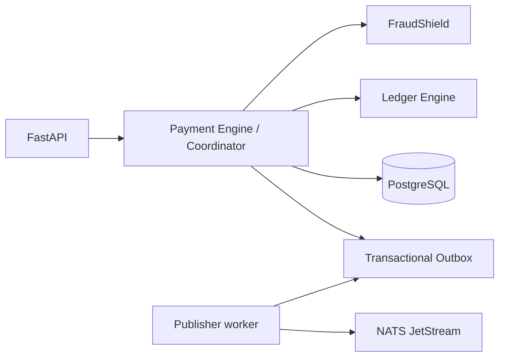

# Arquitetura

OR-TXCORE é um modular monolith: uma API e, futuramente, um processo publisher independente. As fronteiras são estáveis para extração sem o custo operacional precoce de microsserviços.

Bounded contexts: Identity & Access (contrato de autenticação/RBAC, demo admin key); Accounts & Wallets (contas e saldo); Payment Engine (lifecycle); Transaction Coordinator (transação, locks e idempotência); Ledger (journals/entries); FraudShield (políticas); Event Infrastructure (outbox); Audit & Compliance; Observability; Admin/Command. Só Accounts, Payment, Coordinator, Ledger, FraudShield, Outbox, Audit mínimo e health estão implementados.

Extração futura: publique contratos versionados, mova primeiro o publisher/consumers, depois FraudShield ou notificações; pagamentos e ledger permanecem juntos até existir fronteira transacional comprovada.
