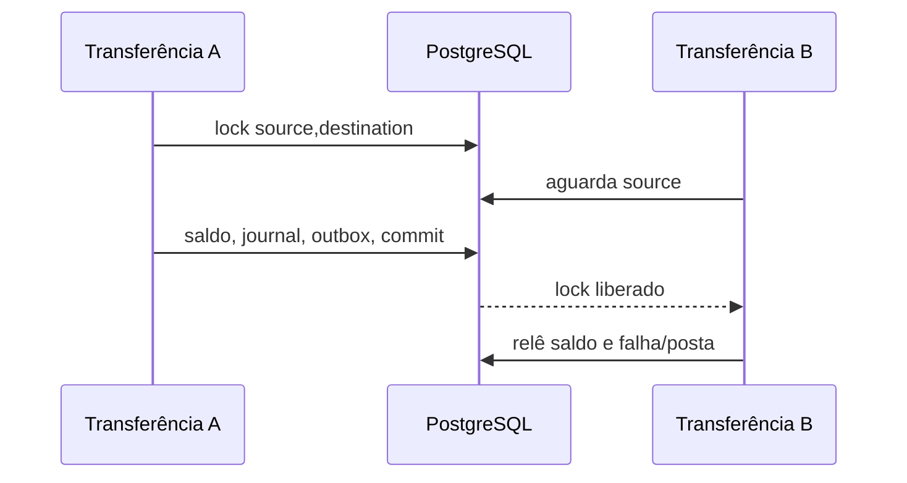

# Concorrência e consistência

O coordinator abre uma transação PostgreSQL, persiste/consulta a idempotência e bloqueia ambas contas com `SELECT ... FOR UPDATE`. Contas são selecionadas em ordem estável de UUID: transferências A→B e B→A não invertem a ordem dos locks. Não há mutex local nem dependência de Redis.

Use `READ COMMITTED` com locks pessimistas para saldo. Trate SQLSTATE `40P01` (deadlock) e `40001` (serialization failure) no adaptador HTTP/worker: retry limitado, com jitter exponencial, somente quando a operação for idempotente. A constraint única de idempotência cobre múltiplos processos; uma colisão durante insert retorna erro transitório de retry. Testes de contenção exigem PostgreSQL real, nunca SQLite.
