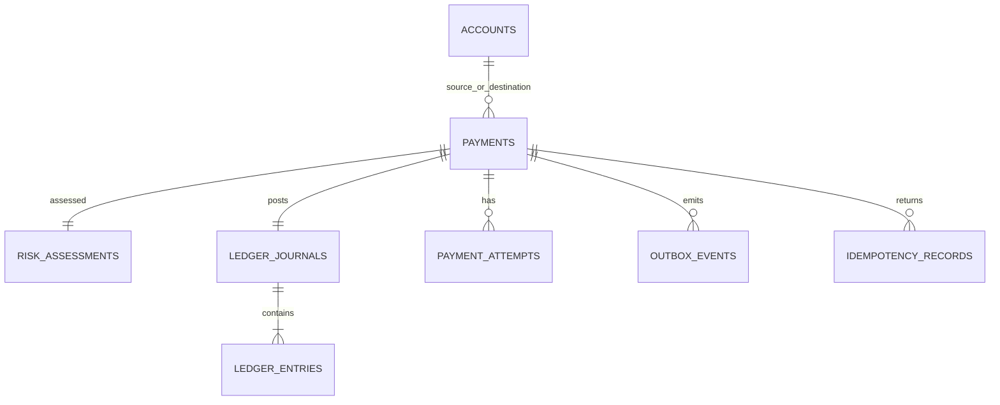

# Banco, invariantes e ERD

Valores financeiros são `INTEGER` em unidades mínimas e `currency` explícita; nunca `float`. `accounts.available_balance_minor >= 0`; payment exige valor positivo e contas distintas; entradas exigem valor positivo e direção debit/credit. `ledger_journals.payment_id` é único; o serviço persiste exatamente duas entradas de mesmo valor numa única transação. Em produção, uma trigger de banco deve reforçar saldo debit=credit e impedir update/delete de journal/entries.

Índices: pagamentos por fonte/data, entries por journal, outbox pendente/data; chave única de idempotência por escopo e evento processado por consumer. FKs protegem referências. `risk_assessments` é um por pagamento.
