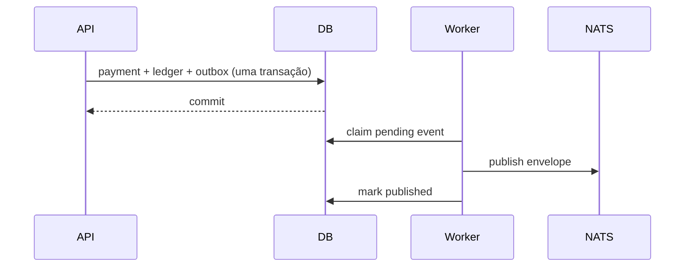

# Eventos e outbox

Envelope: `event_id`, `event_type`, `schema_version`, `aggregate_id`, `correlation_id`, `causation_id`, `occurred_at`, `payload`. Tipos: `payment.requested`, `payment.risk_assessed`, `payment.authorized`, `payment.rejected`, `payment.posted`, `payment.failed`, `ledger.journal_posted`, `fraud.alert_created`.

`app.events.publisher.OutboxPublisher` é o port/adaptador inicial: um adapter NATS JetStream deve implementar `EventBus`. O publisher usa entrega at-least-once: uma falha após publish pode duplicar. Consumers gravam `(consumer_name,event_id)` em `processed_events` antes do efeito e devem ser idempotentes. Ordenação é somente por agregado quando o publisher usar uma chave/stream por aggregate; não há exactly-once distribuído. Mudanças incompatíveis ganham nova versão/tipo, nunca reinterpretam payload histórico.
