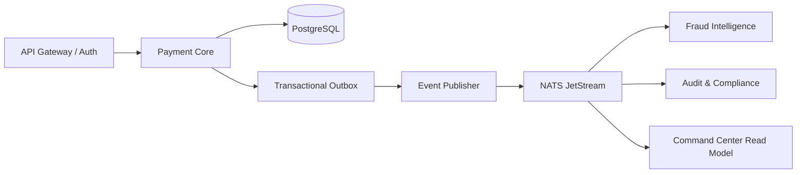

# Evolução para serviços — sem quebrar a correção financeira

O OR-TXCORE começa como modular monolith porque `Payment Coordinator`, `Accounts` e `Ledger` compartilham uma única fronteira ACID. Dividi-los agora criaria uma Saga antes de existir necessidade operacional.

## Serviços a extrair, nesta ordem

1. **Outbox Publisher** — processo independente, sem regras financeiras; lê o outbox, publica eventos e mede atraso/erro.
2. **Command Center Read Model** — consome eventos idempotentemente e constrói a projeção usada pelo painel. Ele pode ficar indisponível sem interromper pagamentos.
3. **Fraud Intelligence** — recebe feature snapshot, devolve score/versionamento; inicia em shadow mode. O Payment Core mantém a política final e tem timeout/fallback determinístico.
4. **Notification/Case Management** — recebe `fraud.alert_created` e opera filas de REVIEW.

`Payment Core` e `Ledger` ficam juntos até existir uma estratégia comprovada de reserva/compensação. Nunca faça débito em um serviço e crédito em outro sem um protocolo de compensação e reconciliação.

## Contratos mínimos

- Todo evento usa o envelope de `docs/EVENTS.md`.
- O consumidor persiste `processed_events` antes de seu efeito observável.
- O publisher oferece *at-least-once*, não *exactly-once* distribuído.
- Todo serviço deve propagar `correlation_id`, `causation_id`, `event_id` e `aggregate_id`.
- O painel consome uma projeção de leitura; ele nunca consulta/escreve o ledger diretamente.

## Modelo de fraude recomendado

O baseline local é `HistGradientBoostingClassifier`, treinado em dados tabulares. Evolua para LightGBM/XGBoost com pesos de classe, calibração e feature importance. Para o OR-TXCORE, medir AUPRC, recall no budget de revisão, latência e calibração é mais relevante que accuracy. Tabular Transformers/TabPFN são experimentos challenger, jamais uma dependência do caminho síncrono de pagamento.
