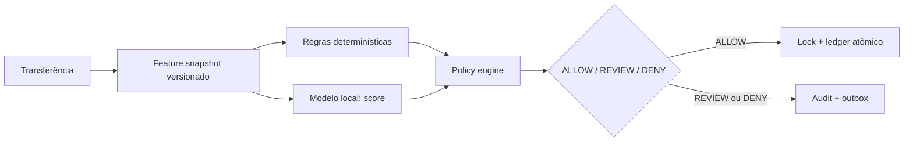

# ML e antifraude local

## Decisão arquitetural

O modelo é um sensor, não uma autoridade financeira. `PaymentService` preserva idempotência, locks e ledger mesmo se o modelo estiver indisponível. A política combina score do modelo, regras explicáveis e contexto; o modelo começa em **shadow mode**, registrando score/latência sem mudar `ALLOW`, `REVIEW` ou `DENY`.



## Dataset local

Para laboratório local, o candidato é `MaxPrestige/credit-card-fraud-CLEAN`, hospedado no Hugging Face, cerca de 71 MB. O card declara uso educacional/pesquisa, mas marca a licença como `other`; portanto o arquivo fica fora de Git e não deve ser redistribuído. Antes de publicação comercial, substitua-o por dados com licença inequívoca ou pelo gerador sintético interno.

Ele é um benchmark de cartão, não dados de conta do OR-TXCORE. O script de treino exclui `gender` e `state` para não transformar atributos/proxies sensíveis em sinal de decisão.

```bash
pip install -e '.[ml]'
python scripts/generate_synthetic_data.py --rows 10000
python scripts/train_local_fraud_model.py
```

O artefato local contém pipeline, versão do modelo, schema de features e métricas. Avalie principalmente PR-AUC, precision/recall no threshold e calibração; accuracy isolada é enganosa em fraude desbalanceada.

## Memória correta

“Memória” significa snapshots imutáveis de features, decisões e eventos correlacionados — não memória livre de um LLM. Cada decisão futura deverá registrar schema, hash da evidência, versão da política, versão do modelo e threshold. Isso permite replay, auditoria e comparação champion/challenger.
